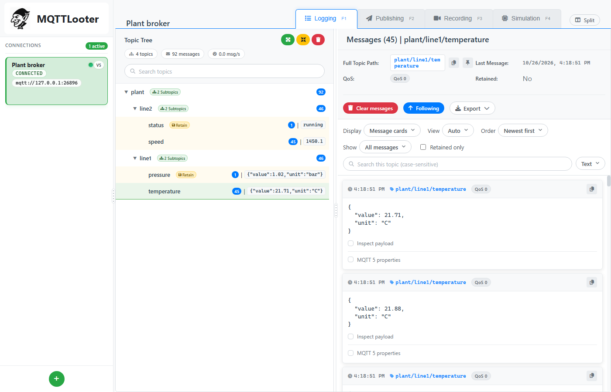
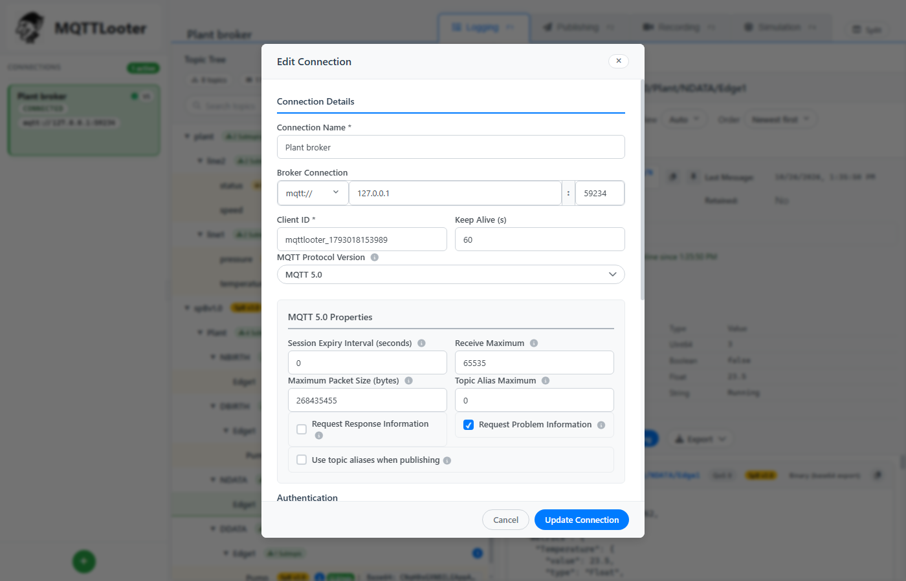
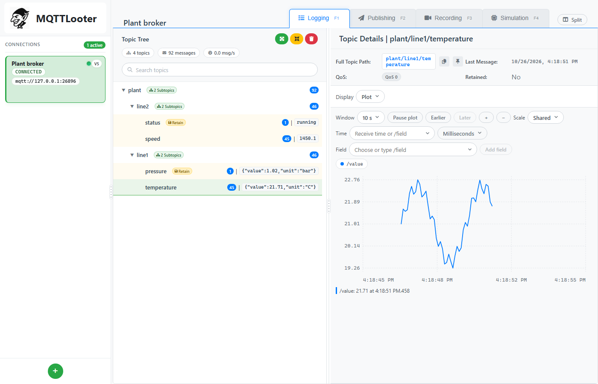
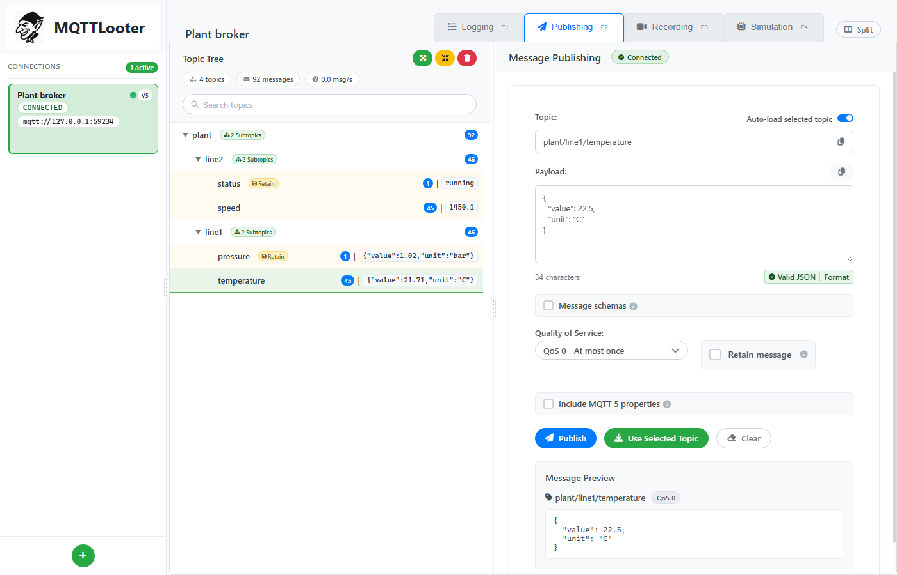
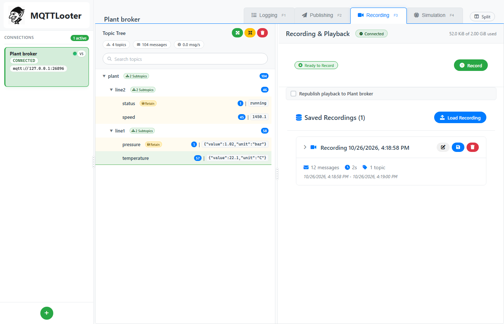
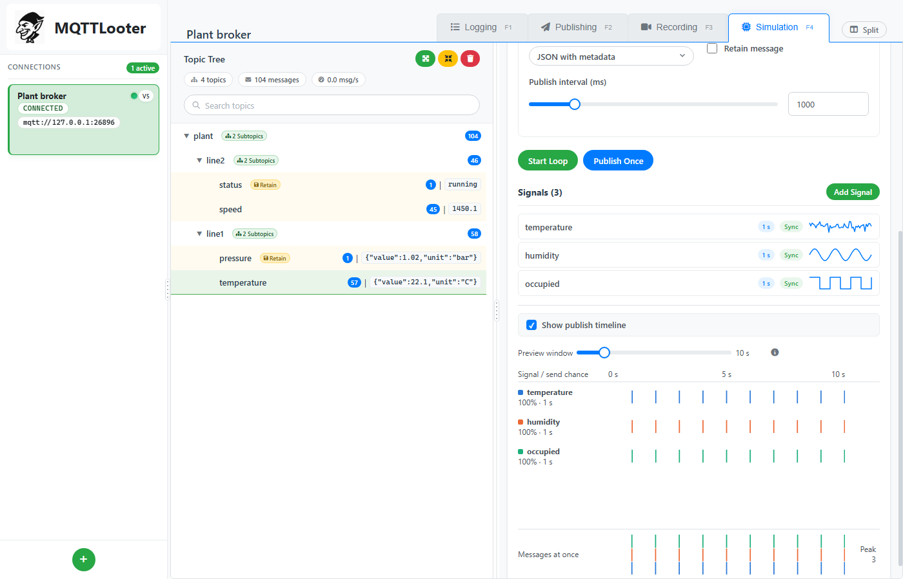
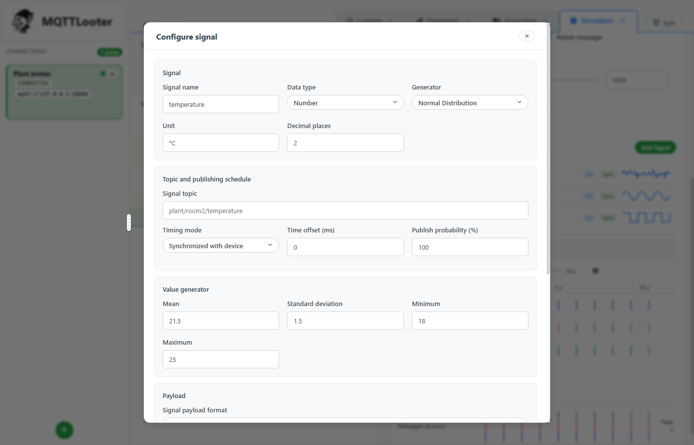
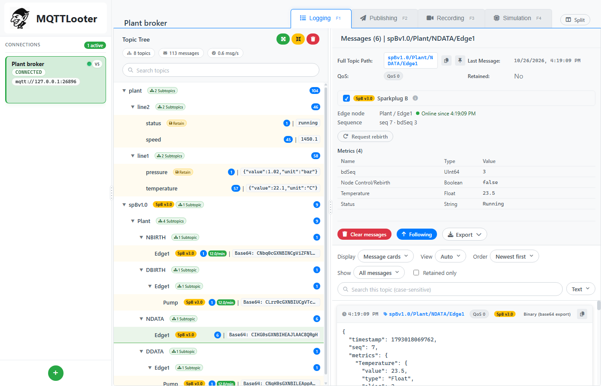
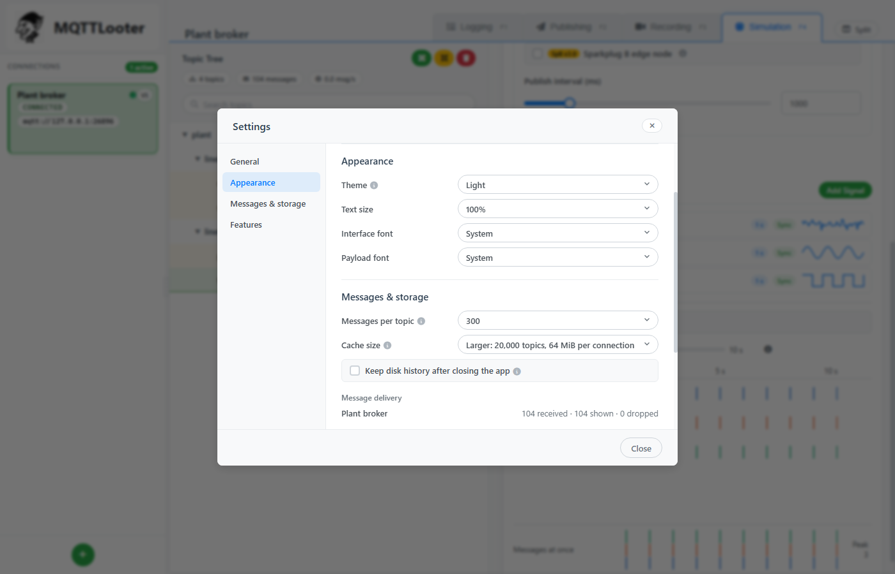
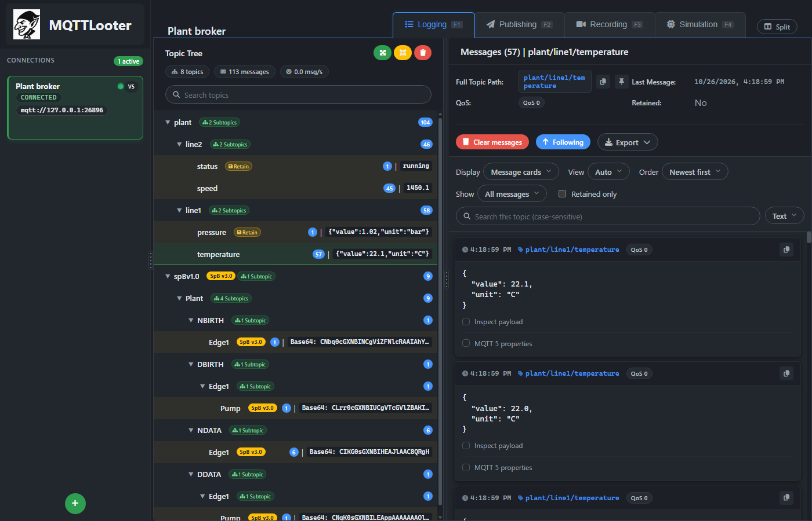

# MQTTLooter

A desktop MQTT client for exploring topics, plotting values, publishing, recording traffic and simulating devices. Built with Electron, React and TypeScript.



## Getting started

Requires Node.js 22.12 or newer.

```sh
npm ci
npm run dev
```

If your shell sets `ELECTRON_RUN_AS_NODE`, unset it first.

| Command | Purpose |
| --- | --- |
| `npm test` | Unit and component tests (also runs a Mosquitto test when Mosquitto is installed) |
| `npm run typecheck`, `npm run lint`, `npm run format` | Static checks and formatting |
| `npm run test:electron` | Builds into `out-test/` and drives the real app against a loopback broker |
| `npm run test:load` | Measures the app under load (`LOAD_PROFILE=full` for 50k topics and 5,000 msg/s) |
| `npm run build` | Production build in `out/` |
| `npm run pack`, `npm run dist` | Unpacked app or Windows installer in `dist-builder/` |

The Electron tests use hidden windows, temporary app data and a local broker; they never touch saved connections.

## Features

### Connections

MQTT 3.1.1 and 5 over TCP, TLS and WebSockets, with client certificates, last will, MQTT 5 connect properties and saved subscriptions. Paste a broker address such as `mqtts://host:8883` into the host field to fill in protocol and port. Passwords, keys and passphrases are encrypted with the operating system's credential store. Connections stay open when the window reloads.



### Logging

The topic tree keeps topics in a stable order, shows message counts, rates, retained flags and the latest payload, and can be searched. Selecting a topic shows its messages as cards (JSON is indented automatically, binary payloads as hex) or as a plain log. **Source > Disk history** pages through everything stored for the topic, and content search finds text, hex bytes or decoded values across a topic or a topic filter. Messages and search results export to JSON or CSV.

Each topic keeps 300 messages in memory by default (100 to 2,000 in Settings). All messages are also written to a disk history for the session, kept for up to 24 hours; turn on **Keep disk history after closing the app** to retain it.

### Plotting

**Display > Plot** charts numeric values over time from disk history. Pick fields from the suggestion list or type a JSON pointer such as `/sensors/0/value`; any JSON structure works, as do plain numbers and decoded protobuf or Sparkplug fields. Up to four fields can be plotted on a shared or per-field scale. Hover for a cursor and value card, pause, zoom, and step through time. The plot pauses while the broker is disconnected.



### Publishing

Publish text, JSON or base64 bytes with QoS, retain and MQTT 5 properties. JSON is validated and can be formatted in place. **Message schemas** store a JSON Schema, topic and options; **Fill payload** generates a message that matches the schema, with typed variables and these placeholders:

| Placeholder | Value |
| --- | --- |
| `{{timestamp}}`, `{{isoTimestamp}}` | Current time in milliseconds or ISO 8601 |
| `{{uuid}}` | A random UUID, shared within one message |
| `{{randomInt(a, b)}}`, `{{randomFloat(a, b, decimals)}}` | Random numbers |
| `{{randomChoice("a", "b")}}` | One of the given values |

A placeholder that fills a whole JSON string keeps its type, so `"count": "{{count}}"` becomes a number. Schemas can be imported from a JSON Schema file and exported.



### Recording and playback

Recordings are captured in the main process, so reloading the window or switching connections does not interrupt them. Each recording is stored in a local database with crash recovery and gap tracking. Play back with speed control, stepping and topic filters, optionally republishing to a broker. Recordings export to and import from JSON files of any size.



### Simulation

Simulated devices publish generated signals: random distributions, waves, ramps, steps, counters, random walks and sequences. A device publishes either one combined payload (named signals or a template) or one topic per signal, each with its own period, offset, random variation and send probability. Start and stop devices from their cards.

The publish timeline previews when each signal sends, one colored lane per signal, with a stacked chart of how many messages go out at once.





### Sparkplug B

Turn on **Sparkplug B** in Settings to decode `spBv1.0` topics with the Eclipse Tahu schema. Metrics are named from birth messages, including those sent by alias. A Sparkplug section in Logging shows node and device state, sequence numbers and current metric values, with a rebirth button. Publishing gains an NCMD/DCMD command builder, and simulated devices can act as edge nodes that send births, data and deaths. Sparkplug topics and tools are marked with a yellow badge.



### Protobuf decoders

Turn on **Protobuf decoders** in Settings, then add `.proto` files and a topic filter under **Decoders** in Logging. Matching messages are decoded in message cards, plots and content search; stored bytes are never changed.

### Settings and appearance

**Tools > Settings** (Ctrl+,) holds the default card view, time format, light or dark theme, text size, fonts, cache sizes, disk history and optional features. The window can show two panels side by side with **Split**, and F1 to F4 switch panels.





## Limits

- Live cache: 300 messages per topic by default, 2 MiB of payload per topic, 20,000 topics and 64 MiB per connection (Compact: 5,000 topics, 32 MiB). Pin up to eight topics to protect them.
- Message delivery to the window is batched and bounded; under overload each topic keeps its newest message and drops are counted in Settings.
- Disk history: 24 hours, about 256 MiB of payload, kept for the session unless set to persist.
- Recordings: a 2 GiB database; individual imported messages up to 1 MiB.
- Decoding: payloads and decoded output up to 1 MiB each.

## Project structure

```text
src/main/        Electron main process: MQTT clients, IPC, storage and decoder workers
src/preload/     Restricted bridge between main and the window
src/shared/      Types and logic shared by main and the window
src/renderer/    React interface: components, hooks, services, styles
tests/           Unit, component and Electron tests
docs/            Roadmap and screenshots
```

Remaining work is listed in [docs/ROADMAP.md](docs/ROADMAP.md).

## Releases and license

Windows installers are attached to [GitHub Releases](https://github.com/MartinJensen37/MQTTLooter/releases), and changes are listed in [CHANGELOG.md](CHANGELOG.md). **Help > About** shows the installed version. Released under the [MIT License](LICENSE).
