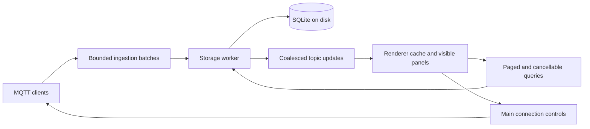

# Remaining implementation plan

Audited 2026-10-22 against the repository through `1834631`. This is a plan, not a claim that the features below are implemented. It replaces the older suggested ordering in [REVIEW.md](REVIEW.md); that document remains the record of fixes and known limitations.

Implementation update (2026-10-23): phase 1 is complete. Signals use compact rows, editor-only payload details and shared chart rendering. Phase 2 now includes separate payload trimming and topic eviction, selected-path protection, eight session pins per connection, live selection metadata, Compact/Larger cache profiles and a shared 128 MiB estimated retained-storage cap. Model coverage includes a 50,000-topic flood. Transport IPC batching and acknowledged queue backpressure are now implemented (8,192 messages / 8 MiB shared pending + in-flight budget, 128-message batch target and short renderer slices), with delivery counters and incomplete-recording warnings. Full-process responsiveness/RSS benchmarking remains open in phase 2; the memory settings are cache budgets, not a process-RAM guarantee. The table below is updated as implementation slices land. Phase 3 now has a worker-owned disk SQLite store, transactional writes with a separate bounded queue, raw payload/MQTT 5 preservation, stable cursor pages, stored-topic search, session cleanup, opt-in restart persistence, retention and a visible stopped-capture state. The Logging source switch exposes history beyond the 300-message cache. Streaming exports, recording migration/checkpoints, durable gap records, richer cancellation and full load benchmarks remain open; phase 3 is not complete.

The inspection backlog also now includes a resizable payload inspector, bounded Pretty JSON with exact numeric lexemes, a bounded selectable plain log, adaptive preview widths, and shared password/passphrase show-hide controls. Incoming numeric plots now read retained disk history, support four numeric fields per topic, shared chart styling, extrema-preserving aggregation, a hover/keyboard sample cursor, pause/resume, zoom and time navigation. New connection sessions and invalid values break lines. Exact-topic content search now scans disk history beyond loaded pages, with literal UTF-8 or hex-byte matching, time windows, stable snapshots and stop/continue controls. Live-cache, disk-page and search-result cards now expose MQTT 5 publish properties, including byte-safe correlation data. Topic JSON/CSV exports retain protocol and normalized properties. Cross-topic search, streaming whole-result export, negotiated topic-alias publishing and OS-backed credential migration remain open.

Phase 5 now includes the planned publish timeline: aligned opportunity ticks, offset schedules, seeded random likelihood bands, per-bin expected-message totals, numeric probability inspection, long-wait descriptions and combined-mode guidance. The preview uses a separate worker and does not consume live random state. Optional actual-event overlays and next-success distribution views remain follow-ups; the preview does not predict broker delivery or scheduling stalls.

UI cleanup (2026-10-25): Display now switches between message cards, plain log and plotting in the same area below topic metadata. Plot mode hides message-only sorting, scrolling, export and pagination controls. Long storage/plot/search/simulator explanations live in documentation rather than the interface. Topic search uses its native clear control and Escape; plot field entry combines suggestions and manual paths. Actionable errors and concise incomplete-data indicators remain.

## Review findings (2026-10-25)

Audited through `b705d91`. Baseline: 164 tests, typecheck, lint and the built Electron smoke pass.

| Finding | Impact | Action |
| --- | --- | --- |
| Recording capture runs in the renderer behind the lossy delivery queue. | Any delivery gap, automatic reconnect or switching the selected connection stops the capture. Captures are capped at 10,000 messages / 2 MB, drop MQTT 5 properties and protocol version, and every save rewrites the whole JSON library. | Next slice: main-owned capture into a disk SQLite recording store (below). |
| `mqtt-get-connections` returned each connection's full config. | Passwords, private keys and passphrases crossed IPC on every status refresh. | Fixed: status omits the config. Required before secrets move to main. |
| `ConnectionProfileService` was unused. | Dead code with public-broker defaults. | Removed. |
| History `clear()` deletes a whole connection in one transaction under the 10 s worker watchdog. | A very large clear can time out and disable history until restart. | Chunk clears; measure in the load harness. |
| History uses `secure_delete=ON`. | Retention deletes overwrite freed pages, roughly doubling write I/O once the cap is reached. | Measure in the load harness before keeping or dropping it. |
| Every successful CONNACK shows "Connected to broker". | Flapping connections produce notification bursts. | Notify only for user-initiated connects. |
| Recording export builds the whole JSON document in renderer memory. | Large recordings can exhaust renderer memory. | Stream exports from main. |
| `tests/` is outside `tsconfig.json`. | Test type errors are not caught by `npm run typecheck`. | Add a test tsconfig in a cleanup slice. |

### Durable recordings slice

- A separate always-persistent `recordings.sqlite` is owned by its own worker and bounded queue. History and recording failures are independent.
- Main starts and stops captures per connection. Messages are written before renderer delivery, so renderer reloads, delivery gaps and selecting another connection do not stop a capture. Explicit disconnect, delete and quit stop it.
- Each batch commits in a transaction, so committed messages survive a crash. On startup, captures left active are marked interrupted at their last committed message.
- Queue overflow, storage errors and automatic reconnects are stored as gap records; the recording is marked incomplete rather than claiming lossless capture.
- The library lists metadata only. Playback and topic filters read pages; export streams chunks to a file chosen in main.
- The legacy `recordings.json` library and any localStorage copy are imported idempotently. The JSON file is kept as `recordings.json.migrated` once its counts are verified.

## Current implementation status (2026-10-25)

| Request | Current status | Remaining work |
| --- | --- | --- |
| Stable topic tree and topic search | Virtualized stable ordering, anchored scrolling, search, live selection and eight session pins per connection. Refreshes do not depend on animation frames; renderer readiness gates delivery across reloads. | Sustained-load responsiveness and full-process memory measurements. |
| Message scrolling and sorting | Anchored live scrolling, stable timestamp ties and fixed disk-history snapshots. | Explicit expired-anchor notices across retention and richer search-page navigation. |
| Simulator stop on disconnect | Implemented, including manual restart after reconnect/reload. | Keep regression coverage as scheduling and layouts change. |
| Per-signal destinations and timing | Individual topics, fixed/random periods, offsets, send probability and publish timeline. | Optional actual-event overlays and next-success distribution views. |
| Interval slider down to 0.1 s | Implemented, with an exact number field. | Reuse existing control. |
| Extra waveforms | Sine, square, triangle, sawtooth, ramp, step, first-order step response, counter and random walk implemented alongside existing generators. | Composable message fields. |
| Small waveform previews | Compact signal rows with tiny patterns; editor charts show three cycles for periodic waves or one transition, with labeled axes. | Keep responsive/keyboard coverage as editors evolve. |
| Incoming topic plots | Four numeric fields, disk queries, shared chart styling, extrema aggregation, zoom, pause and cursor. | Payload timestamps, independent axes, adaptive point budgets and sustained-load measurements. |
| Message-content search | Exact-topic disk search beyond loaded pages, text/hex, fixed time windows and stop/continue. | Cross-topic search, reverse paging, custom times, oversized-payload streaming and full-result export. |
| Payload inspection | Text/hex, Pretty JSON, resizable inspector, plain log and adaptive previews; byte-preserving copy/export. | On-demand large-payload fetching and streaming exports. |
| Templates and schemas | Typed JSON substitutions, editable variable defaults, safe text escaping and per-application timestamp/UUID values; basic nested validation. | Full supported JSON Schema dialect, schema-driven construction and shared simulation fields. |
| Plain simulator payloads | Raw UTF-8 scalar output, device defaults/per-signal overrides, exact text/hex previews and versioned legacy migration. | Composable typed fields and schema-driven payload construction. |
| MQTT 5 properties | Live/disk inspection and exports preserve metadata. Publisher supports response topic, correlation bytes, content type, expiry, payload format and repeated user properties with main-process validation. | Broker-negotiated alias lifecycle and broader real-broker interoperability tests. |
| Memory and throttling | Acknowledged transport batches, per-connection/shared budgets, protected topic metadata and worker-owned disk history. | Sustained input-latency/RSS benchmarks, durable gap records and streaming recordings. |
| Recordings in a database | In progress (see durable recordings slice). Saved recordings currently use an atomic JSON disk library. | Streaming capture, durable checkpoints, lazy loading and migration. |
| Responsive disconnect control | MQTT clients already run in main; sidebar is in the shared renderer. | Bound work in both processes, move storage/decoding to workers, measure disconnect responsiveness. |
| Multiple tiled panels | Not implemented; current tabs preserve mounted workspaces. | Dockable layout with explicit panel lifecycle and persistence. |
| Protobuf / Sparkplug B | Not implemented. | Schema-selected decoding first; Sparkplug B remains an optional later feature. |
| Password visibility | Shared password/passphrase show-hide controls. | Main-managed OS-backed credential storage and migration. |
| CSS cleanup and refactoring | Shared tokens/controls and simulator scoping exist; older globals and broad JS types remain. | Incremental cleanup in touched features, scoped styles, typed service boundaries. |
| Lazy loading | Virtual topic/signal rows, paged history and lazily mounted property details. | Panel modules, recording metadata/payload pages and decoder assets. |
| Documentation | README, simulator guide and review notes exist. | Update with each feature and add usage examples for storage, plots and timing. |
| TLS / WebSocket verification | Configuration exists; automated desktop coverage currently uses loopback MQTT TCP. | Real-broker integration matrix, failure cases and release testing. |

Keep the completed saved profiles, clear-history action, sidebar collapse, notifications, dropdown controls and template import. Retained-message removal currently prioritizes the selected topic over the publishing form; preserve that behavior. Do not rebuild these features solely because they appear in the old backlog.

## Findings from MQTT Explorer

Reviewed upstream revision `35f31973c456a024a37450f5961e4610dc9a9ce0`, rather than assuming its behavior from screenshots:

- Topic nodes have a small bounded ring history, configured for 100 messages and a 20,000-unit payload-length budget. Latest message and node metadata are separate from that history. This supports separating topic existence from payload retention in our model. [TreeNode](https://github.com/thomasnordquist/MQTT-Explorer/blob/35f31973c456a024a37450f5961e4610dc9a9ce0/backend/src/Model/TreeNode.ts), [RingBuffer](https://github.com/thomasnordquist/MQTT-Explorer/blob/35f31973c456a024a37450f5961e4610dc9a9ce0/backend/src/Model/RingBuffer.ts).
- Incoming tree changes are collected and merged on a 300 ms cycle. Its pending-change buffer has a roughly 100 MB estimated limit and stops accepting additions when full. These are useful batching patterns, not evidence of unlimited or lossless capture. [Tree](https://github.com/thomasnordquist/MQTT-Explorer/blob/35f31973c456a024a37450f5961e4610dc9a9ce0/backend/src/Model/Tree.ts), [ChangeBuffer](https://github.com/thomasnordquist/MQTT-Explorer/blob/35f31973c456a024a37450f5961e4610dc9a9ce0/backend/src/Model/ChangeBuffer.ts).
- An open chart subscribes to its topic, starts from available history, keeps a separate 500-message buffer and throttles redraws to 300 ms. Plotting supports scalar values or selected JSON paths. We should similarly separate chart refresh frequency and retained samples from message arrival. [TopicChart](https://github.com/thomasnordquist/MQTT-Explorer/blob/35f31973c456a024a37450f5961e4610dc9a9ce0/app/src/components/ChartPanel/TopicChart.tsx), [TopicPlot](https://github.com/thomasnordquist/MQTT-Explorer/blob/35f31973c456a024a37450f5961e4610dc9a9ce0/app/src/components/TopicPlot.tsx).

These inspected paths use memory buffers, not SQLite. They do not establish performance on our workload. Implement our own components using these architectural ideas. No upstream code has been copied; its [license file](https://github.com/thomasnordquist/MQTT-Explorer/blob/35f31973c456a024a37450f5961e4610dc9a9ce0/LICENSE.md) identifies Attribution-NoDerivatives and additional attribution requirements, so direct source reuse is not assumed.

## 1. Simplify the simulator overview

Keep the device list and device editor. A device remains a named group of signals with shared defaults and clock; a node-graph editor adds little value until signal dependencies exist.

- Replace signal cards with one approximately 36-40 px row: name, interval pill, sync-mode pill, small pattern at the right. Keep an unobtrusive edit affordance; put delete and detailed configuration in the signal editor.
- Long names truncate with an accessible full label. Interval and mode are text as well as color. Use shared button, pill, field and select styling; check keyboard access and the minimum window width.
- Use an approximately 100 x 24 px sparkline without axes/caption in the row. Show three cycles for periodic signals, a representative seeded pattern for random generators, and a compact type/pattern indicator for other values. Do not animate every row or advance live generator state to draw previews.
- Move destination, parameters, current value, payload example and last-publish details into the individual signal editor. Remove payload blocks from the overview. Keep labeled axes and three cycles in the expanded editor. Combined-device mode can expose its complete payload in a dedicated details section, not the signal list.
- Extract a small shared plot frame/axis/theme layer from `SignalWaveform`; keep simulator sampling separate from rendering so incoming plots can supply their own points later.

Acceptance: many signals fit in a compact list; rows remain one line at 800 px window width; opening a signal exposes all details; scrolling the overview does not trigger publishing or mutate a counter/random walk.

Suggested commits: `Simplify signal rows`, `Share plot styling`.

## 2. Keep inspected topics available under load

At the initial audit, defaults were 300 messages / 2 MiB raw payload per topic and 32 MiB estimated retained storage / 50,000 messages / 5,000 tree nodes per connection. The implemented Larger profile now uses 64 MiB and 20,000 nodes; Compact retains 32 MiB and 5,000 nodes. Both share a 128 MiB cache cap across connections. Node counts include ancestors. The 300-message cap remains a live-cache limit; disk history already browses beyond it.

- Separate the topic catalog, selected topic identity, latest-value cache and historical payload cache. Trim old payloads before removing topic metadata. Refresh selection from the live model instead of a stale node snapshot.
- Protect the selected topic and its ancestor path; allow a bounded set of explicitly pinned topics. Preserve their identity while allowing old payloads to expire. Pins cannot reserve unlimited memory or bypass user deletion/retention policies.
- Resource profiles and a shared cache cap are implemented: Larger uses 64 MiB per connection and up to 20,000 metadata nodes, within a 128 MiB aggregate retained-cache budget; Compact keeps the previous limits. Metadata and payload bookkeeping are included in the estimate. Model/load checks verify those bounds; pending transport batches are also bounded. Full-process memory measurements are still needed before claiming a process-RAM target.
- Batch incoming IPC by elapsed time and byte/count thresholds. Keep exact sequence IDs and timestamps. Coalesce replaceable tree/rate updates separately from archival messages; do not discard history just because its UI update was coalesced.
- Bound pending batches and decoding work; report received, stored, expired and dropped counts separately. Reserve prompt handling for connect/disconnect/cancel commands. Remove notification bursts and redundant hidden-panel updates.

Acceptance: a local retained flood cannot silently remove the selected topic, pinning remains bounded, history trimming is visible, and disconnect works during sustained traffic. Test multiple connections and very large/empty payloads, not just message counts.

Suggested commits: `Preserve selected topics`, `Add history budgets`, `Batch message updates`.

## 3. Add disk-backed history and streaming recordings

In-memory SQLite still consumes RAM and disappears when closed; moving it into main would move the memory cost without solving retention. Use a local disk-backed SQLite database owned by a main-managed worker, with bounded memory caches. Choose the SQLite binding after a small spike checks the installed Electron runtime, transactions, cancellation and Windows packaging. [SQLite in-memory databases](https://www.sqlite.org/inmemorydb.html).

- Define a history service first: append batch, page messages, search topics/content, query numeric series, retention, clear and export. Use session/connection identity plus monotonic sequence numbers; cursor pagination must remain stable when new messages arrive or timestamps tie.
- Store exact topic paths, raw payload bytes, receive timestamps, QoS, retain and normalized MQTT 5 properties, including binary correlation data. Keep topic metadata separate; index topic/session/sequence and time queries. Do not use display truncation as stored data.
- Renderer caches contain visible tree branches, current message pages and requested numeric series. Older messages load on demand; 300 becomes an initial page/cache choice rather than the total retained-history limit. Uncached topics remain searchable through the catalog.
- Use transaction batches and evaluate WAL for concurrent reads. Bound query lifetimes, page cache, write queue and WAL growth; checkpoint outside UI work. WAL has its own maintenance and concurrency constraints. [SQLite WAL](https://www.sqlite.org/wal.html).
- Provide session-only disk history as the initial default, with an explicit option to retain across restarts. Define cleanup after crashes and retention by age and total disk bytes, including database/WAL overhead. Export and deletion must show their scope. Start by testing a 1 GiB disk quota; finalize the default from measurements.
- On queue overflow or disk failure, stop durable capture visibly and expose the gap; keep browsing under a bounded policy. Never claim lossless recording after a discard. A later explicit strict-capture option may disconnect instead. MQTT QoS is not a guarantee that the app stored a message.
- Stream active recordings into the same store with recording membership and checkpoints; list metadata without reading every payload. Migrate the current JSON library idempotently, verify counts/bytes and retain a recovery copy until migration succeeds. Stream exports and playback pages.
- Validate IPC requests and cancel obsolete queries when panels, topics or connections change. Storage and expensive parsing stay off main's connection-control event loop. If transport parsing itself proves a bottleneck, move MQTT clients into a supervised worker in a separate measured change.

Acceptance: browse/export more than 300 messages per topic with bounded renderer memory; restart recovery, partial-batch failure, disk-full, retention, migration retry, duplicate timestamps and binary round trips pass. Retention never leaves selection pointing at a removed UI object; expired history is identified. Verify the packaged Windows app, not only Node tests.

Suggested commits: `Add history storage`, `Page message history`, `Stream recordings`.

## 4. Plot incoming data and improve inspection

Property inspection slice (2026-10-24): message cards lazily expose received MQTT 5 properties in live history, disk pages and content-search results. Correlation bytes use a hex preview and full base64 copy; repeated user properties and subscription identifiers remain separate rows. Zero/false values are preserved. Expiry and aliases are labeled as received values, not a countdown or a reusable publisher alias. JSON/CSV topic exports include protocol version and normalized properties. The live cache now retains properties and counts them against topic and aggregate budgets. Previews are capped at 64 rows, 1,024 characters per value, 128 characters per label and 256 correlation bytes; copying/export preserves full values. Publishing controls and remaining alias work are tracked in phase 6.

Content search slice (2026-10-24): choose **Source > Disk history > Search message contents**. Searches are scoped to the exact selected topic and a fixed 5-minute, 1-hour or 24-hour received-time window. UTF-8 matching is literal and case sensitive; hex matching inspects raw bytes. Worker requests scan at most 2,000 rows / 8 MiB with a 25 ms target. Time filtering occurs inside that bounded scan, so a time range with no matches cannot turn into an unbounded SQL scan. The renderer requests one chunk at a time and yields between them; Stop, hiding the panel, editing criteria or changing topics prevents further requests and ignores pending replies. A current bounded chunk may finish; this does not interrupt SQLite mid-statement.

Each result page holds up to 100 matches / 1 MiB estimated. Continue searches older records with the same snapshot/cursor; a new search includes newly captured messages. Oversized payloads (>256 KiB) or records (>1 MiB estimated) are skipped and counted. Text mode counts non-UTF-8 skips. Expired records remain unavailable; clear invalidates cursors. Copy/export is limited to displayed matches, and **Clear topic history** explicitly clears the whole topic rather than only matches. Cross-topic search, reverse page navigation, custom time boundaries, large-payload streaming search and whole-result streaming export remain follow-ups.

Implemented slice: **Display > Plot** in Logging works for live-selected and stored-only topics. Queries run in the storage worker with a topic/time index; schema version 1 upgrades without replacing messages. The renderer requests at most four fields and 512 points per field, no more than once per 250 ms after the previous query finishes. A query scans the newest portion of the range, stopping at 20,000 records, 8 MiB of decoded payloads or a 75 ms work target; omitted older samples are reported. Each payload is limited to 64 KiB for numeric parsing. Invalid/missing values break their whole aggregation bucket conservatively, so a sparse invalid sample can suppress nearby connecting lines. Closing the plot or hiding Logging stops polling. Plot configuration remains when switching tabs.

Numeric JSON fields use JSON Pointer paths, including arrays and escaped keys. Numbers use JavaScript floating-point precision; original payload bytes remain unchanged. Plotting currently uses receive timestamps and a shared Y scale. Payload timestamps, independent axes and adaptive point budgets based on exact chart width remain follow-up work. The original acceptance targets below also include that unfinished work.

- Add Plot beside topic/payload inspection. Begin with numeric text and finite numeric JSON fields; use escaped field-path segments so dots/slashes in keys are unambiguous. Missing, invalid or binary values become gaps, never zero. Decoder outputs can feed the same interface later.
- Reuse the plot frame, colors, axes and formatting from phase 1. The data adapter differs: simulation supplies generated points; incoming plots supply timestamped stored samples. Default to receive time, preserving sequence order for ties; optional payload timestamps must be explicitly selected and validated.
- Support several selected series, a legend, hover values, time-range selection, zoom, pause/resume and remove. Pause freezes the visible range while capture continues. Do not connect disconnected sessions or missing-data gaps with misleading lines.
- Query only the visible time range. Downsample in the worker to a pixel-related point budget using extrema-preserving buckets; show sample/aggregation information. Keep bounded live-series buffers and redraw at roughly 5-10 Hz, independently of ingestion.
- Add a resizable payload inspector with raw text, pretty JSON and hex; copy/export retain original bytes. Fetch large payloads on demand. Adapt collapsed preview length to available width without rendering whole payloads.
- Add message-content search across stored history with topic/time/encoding scope, cancellable paged results and clear truncation/retention notices. Start with literal text search; evaluate indexing from real query costs. Binary search is an explicit hex mode. Add a plain-text log view and bounded selection/export for copying multiple messages.
- Preserve MQTT 5 properties end-to-end and display correlation data, response topic, content type, expiry and user properties when present.

Acceptance: replay a known waveform through a local broker and compare generated versus incoming plots; test spikes after aggregation, invalid JSON, numeric strings, arrays, missing fields, burst timestamps and paused views. Search finds messages outside the loaded page and cancels promptly.

Suggested commits: `Plot topic values`, `Improve payload inspection`, `Search stored messages`, `Show MQTT 5 properties`.

## 5. Visualize message timing and probability

Implemented (2026-10-23): the collapsible device timeline defaults to 10 seconds, offers 5/10/30/60-second horizons and uses 128 bins. Fixed opportunities follow the scheduler's period/offset rules; random delays reuse its bounded-delay function and model integer-millisecond callbacks. Random rows average 512 seeded timing trajectories, calculating send probability analytically within each trajectory. This keeps 1% signals visible without sampling away rare sends. A fixed-schedule 99% first-send time is described even when outside the window; 0% is explicitly never.

Rendering is virtualized to ten rows at a time, and computation is capped at 128 signals with an explicit exclusion notice and scoped aggregate. A worker is created only while calculating; edits are debounced, live sample changes reuse results, and closing/changing settings terminates obsolete work. Nonzero colors have a documented visibility floor, accompanied by numeric probabilities and an accessible time-bin slider. Fixed rows are exact under the stated no-stall assumptions; random per-bin sampling uncertainty is approximately ±4.4 percentage points at 95% confidence in the worst case. The original scope below includes optional actual-event overlays and a next-success distribution view, which remain unimplemented.

Add a collapsible **Publish timeline** below the device's signal list. This visualizes when messages may be sent; the small waveform shows what value a signal generates. Keep those meanings distinct.

- One row per signal on a shared time axis. Fixed schedules use narrow event ticks, synchronized ticks align vertically, and offsets shift them. Add a bottom aggregate showing expected messages per time bin to expose bursts.
- Use a fixed default 10-second horizon with selectable shorter/longer windows and a hard maximum (initially 60 seconds), at most 256 time bins, and virtualized rows. Long-period signals show their next eligible time even if it is outside the window. Zoom changes bin width, not the schedule.
- For fixed opportunities with probability `p`, tick opacity represents `p`; for a bin containing `k` independent opportunities, probability of at least one send is `1 - (1 - p)^k`. Tooltips show the numeric likelihood, interval and assumptions, so meaning does not depend on color alone.
- Random interval variation currently draws bounded delays and clamps them to 100 ms. Model those actual rules, including offsets and the clamp. Draw per-bin likelihood bands with a consistent legend. Use a bounded, seeded sampling calculation in a worker for multi-event random schedules; label estimates and cache results until settings/horizon change. Do not advance the live RNG or advertise an illustrative sample as a prediction.
- Do not simply hide every bin below 1%: a signal with 1% publish chance should remain understandable. The time horizon is the primary bound. An optional next-success view can use 99% cumulative coverage with a clearly marked omitted tail; this is different from a density/opacity cutoff.
- Even fixed periods can have an unbounded wait for a successful send when opportunities may be skipped. For independent probability `0 < p < 1`, 99% coverage takes `ceil(log(0.01) / log(1-p))` opportunities. Handle `p=0` as never and `p=1` as the first opportunity; cap display duration regardless. This probability concerns scheduler decisions, not network delivery or acknowledgement.
- Planned previews assume the connection is available and publishes do not stall. Optional actual-event markers show accepted publishes and skipped/busy ticks during a run; their counters distinguish timing probability from backpressure and network failure. Combined mode must indicate its completion-dependent timing.

Acceptance: compare preview ticks against fake-clock scheduler traces; test alignment, offsets, zero jitter, 100 ms clamp, 0/1/100% chance and long periods. Seeded random estimates must agree with known fixed/chance cases within stated tolerances, remain stable on re-render and complete within a bounded workload.

This phase depends on the schedule model and phase 1's visual components, not SQLite, so it can land while phase 3 is being developed.

Suggested commits: `Preview publish schedules`, `Show timing probabilities`.

## 6. Complete payload construction and publishing

Typed template slice (2026-10-25): Publishing now expands whole-value JSON placeholders as their actual types, escaping inserted text once while retaining unrelated numeric lexemes and whitespace. Declared defaults and editable text/number/integer/boolean/JSON variables feed an explicit Apply template action. Timestamp and UUID are shared within one application; Publish sends the visible draft unchanged. Topic handling preserves manual selections, property settings follow the template, and expansion failures preserve the old draft with an actionable error. Shipped templates now satisfy their existing schemas. The shared pure expander is ready for reuse, but simulator field composition, a full schema validator and schema-driven construction remain unimplemented.

Transition signal slice (2026-10-25): numeric signals now support ramp, step and first-order step response, with starting/final values, transition delay and duration/time constant. They use elapsed time, retain existing individual/combined time origins, support rising/falling transitions and work in JSON/raw output. Compact patterns and editor charts use the shared plot; exact boundaries and bounded extra response samples avoid misleading previews for short transitions after long delays. Skipped/busy publishes do not slow the transition. Nested typed fields, timestamp/UUID sources and schema-driven construction remain open.

Raw simulator slice (2026-10-24): JSON remains the default, with raw UTF-8 scalar output configurable per device and per individual signal. Combined raw mode requires one signal. Text/hex previews show exact serialization and byte counts, with bounded rendering and full copying; last-published previews retain the original format. Multiline strings, empty strings, Unicode, booleans and rounded numbers are covered. Unversioned devices migrate to per-device schemaVersion 1 while preserving JSON envelopes; unknown versions/formats preserve saved data and report an error. Nested typed builders and standards-compliant schema validation remain open.

Publish-property slice (2026-10-24): the Publishing editor now offers opt-in response topic, content type, expiry, payload format, hex/base64 correlation and repeated user-property fields using shared controls. Properties follow the existing App/MQTTService publish path into main, where shared validation rejects invalid UTF-8 strings, wildcard/empty topics, invalid QoS/retain, unsupported properties, MQTT 3 misuse, malformed binary data and UTF-8 format/payload mismatches. App limits are 64 user pairs and 64 KiB of encoded properties. Correlation stays binary through JSON-safe draft/history storage and conversion to the MQTT client's Buffer.

Properties persist with per-connection drafts and successful publication history, with property-aware deduplication. History reload preserves zero/false/empty fields. Use Selected Topic resets properties rather than replaying received broker metadata; retained-message deletion is always a clean empty retained publish. Oversized saved user-property lists render at most 64 rows and require correction before sending. Narrow publishing layouts now respond to pane width and reduce nested padding. Topic aliases and outbound subscription identifiers are rejected; negotiated alias lifecycle remains open. The checklist below retains the full scope; implemented portions are described in the slices above.

- Introduce typed field sources shared by publisher and simulator: literal, timestamp, UUID, counter/ramp, step, first-order step response and existing generators. Define reset, time origin and UUID lifetime (per message or stable per device) explicitly. Allow several sources in one nested payload without evaluating arbitrary code.
- Add raw-text/scalar output with an exact byte preview; JSON-only metadata wrapping must not silently appear in basic mode. Preserve existing saved-device formats through a versioned migration.
- Adopt a maintained standards-compliant JSON Schema validator for a declared dialect. Resolve local references and validate generated values as their real types; separate schema import, example generation and validation errors. Test nested arrays/objects, required fields, enums, bounds and combinators.
- Add MQTT 5 publisher fields for response topic, correlation bytes, user properties, content type and expiry, with version-aware validation. Topic aliases require broker-negotiated limits and reset on reconnect; expose them only with correct lifecycle handling.
- Add password/passphrase visibility controls. Complete existing credential-storage work before external release: move secrets from renderer localStorage to main-managed OS-backed storage with migration and a clear fallback policy.

Acceptance: saved templates/devices remain compatible; schema types survive expansion; raw bytes match the preview; MQTT 3 connections do not receive MQTT 5-only properties; aliases and correlation data pass real-broker tests.

Suggested commits: `Build typed payload fields`, `Validate message schemas`, `Add publish properties`, `Improve credential controls`.

## 7. Workspaces, decoding and focused cleanup

- Add resizable tiled panels after panel data contracts and subscriptions are independent of tab visibility. Start with two panes, then saved layouts. Scope topic/connection selection per pane and define whether a pane follows global selection or is pinned.
- Lazy-load heavy panel modules, chart tooling and decoder schemas. Unmounting a hidden editor must not accidentally start/stop simulation or recording; move their lifetime to explicit services before changing mounting behavior.
- A sidebar DOM component cannot simply run in a worker. Keep the main-managed control path responsive through bounded updates and workers first. If load tests still show an unusable disconnect button, add a small separate control-window renderer or native disconnect action, justified by measurements.
- Add a decoder registry preserving original bytes: text/JSON/hex first, then user-provided protobuf descriptors and message types mapped to topic filters. Decode off the UI thread with size/depth limits and readable errors; do not guess protobuf schemas. Plot decoded numeric fields through phase 4's adapter.
- Keep Sparkplug B optional until protobuf support exists. A useful Sparkplug view needs birth/death state, metric aliases and sequence/session handling, not just a protobuf decoder or extra tab.
- Refactor one feature boundary at a time: consolidate duplicate limits/search helpers, remove confirmed unused functions/styles, type IPC/history/scheduler contracts, and scope remaining CSS. Reuse common controls and tokens throughout. Avoid a broad rewrite that obscures behavior changes.

Acceptance: two panes retain independent selection/scroll, layout persistence survives restart, closing a pane releases subscriptions, and expensive decoding cannot block connection controls. Run visual checks at narrow/wide sizes and keyboard/focus checks for all new controls.

Suggested commits: `Add tiled workspaces`, `Load panels on demand`, `Decode protobuf payloads`; separate small cleanup commits by component.

## 8. Validation and release gates

Every phase includes targeted regression tests, typecheck/lint/build where relevant, and documentation updates. Current baseline: 164 tests plus a built Electron smoke test with an isolated loopback broker. This is functional coverage, not yet a high-throughput benchmark.

- Build a repeatable local-broker load harness: retained floods at 5,000, 20,000 and 50,000 topics; mixed payload sizes; deep/empty topic levels; slow acknowledgements; reconnects; multiple connections; recording and plotting together. Measure main/renderer/worker RSS, queue sizes, storage throughput, UI latency and dropped counts separately.
- Initial performance targets to validate on the development machine: 50,000-topic discovery, 5,000 small messages/second for 60 seconds, p95 input feedback under 100 ms and disconnect initiation under 500 ms. Record hardware and payload sizes; revise targets with evidence. Acceptance also requires memory to plateau at configured caches and overload to remain explicit. Do not stress-publish to public brokers.
- Add real-broker MQTT 3.1.1/5, WS/WSS paths, TLS trust/hostname failures, client certificates, authentication failures, QoS 1/2, session expiry and reconnect tests. Verify MQTT 5 binary properties and simulator stop/restart semantics.
- Exercise storage corruption/recovery, active-capture restart, disk exhaustion, long-running retention and migration. Validate installer packaging/upgrades separately from the hidden Electron smoke test.
- Keep README and simulator documentation accurate as each slice ships. Add a short test checklist and diagnostics export without credentials/payloads by default. Distribute a build for user testing only as an explicit release step; collect broker/load details and reproducible failures.

## Delivery order

Current order (2026-10-25): durable SQLite recordings, then the local-broker load harness from phase 8, then credential storage, then the remaining phase 4/6 items.

Original order: start with compact signal rows, then selected-topic protection and measured budgets. Establish the storage/query contract before expanding incoming plots; finish disk history and recording migration in small slices. Timing visualization can follow the compact rows without waiting for storage. Complete construction/inspection features next, then tiled workspaces and optional decoders.

Each commit should contain one reviewable change with a short simple message and no co-author trailer. Do not mark the larger storage, plotting or timing work complete based only on scaffolding or a static preview.
